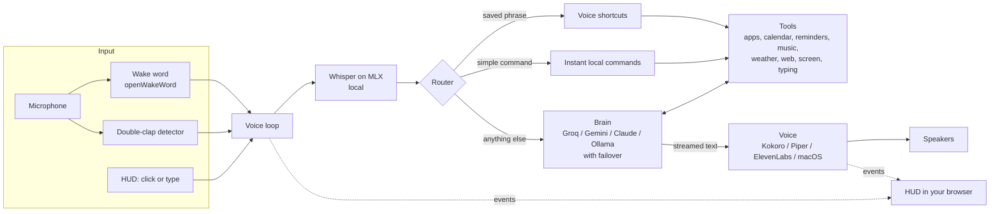

<p align="center">
  
</p>

<h1 align="center">Jarvis</h1>
<p align="center"><b>A voice-controlled AI assistant for your Mac, with a glowing HUD.</b><br>
Say "Hey Jarvis" or clap twice. It listens, thinks, acts on your Mac and talks back in a natural British voice.<br>
Runs on free tiers, or fully offline.</p>

<p align="center">
  <a href="https://github.com/YOUR-USERNAME/jarvis/actions/workflows/ci.yml"></a>
  
  
  
</p>

---

## What it does

- **Hears you three ways:** the wake word "Hey Jarvis", a double clap, or just typing into the HUD. Speech recognition is local ([Whisper on Apple's MLX](https://github.com/ml-explore/mlx-examples/tree/main/whisper)), so your voice never leaves your Mac.
- **Acts on your Mac:** opens and closes apps, sets volume and timers, types into any app (including the Claude app), runs your Apple Shortcuts, controls Spotify or Apple Music, and reads and writes your **Calendar and Reminders**.
- **Knows things:** live **weather** and **web lookups** (no API key needed), and it can **look at your screen** and answer questions about it.
- **Answers instantly when it can:** "what time is it", "volume 30", "open Safari", "set a timer for five minutes" are handled locally in milliseconds, with no AI call.
- **Talks back naturally:** sentence-by-sentence streaming with a free local British voice ([Kokoro](https://github.com/thewh1teagle/kokoro-onnx)). Double-clap to interrupt it mid-sentence.
- **Remembers you:** durable memory ("remember I live in London"), follow-up questions without repeating the wake word, and a **switchable personality** (classic, butler, friendly, sarcastic, minimal, or one you describe).
- **Your own voice commands:** say "make a shortcut called study mode that opens Notes and Safari", or edit a JSON file.
- **Never stops working:** if the main AI is rate-limited or offline it fails over to a backup brain automatically.
- **Built to be trusted:** risky actions need a spoken yes, and text from the web or your screen can't trick it into running commands. See [Security](#security-and-privacy).

<p align="center"></p>

## Quick start

You need an Apple Silicon Mac (M1 or later), macOS 14 or newer, and about 3 GB of free disk space for the speech models.

```bash
# 1. Python 3.12 in a virtual environment
brew install python@3.12
python3.12 -m venv ~/jarvis-env && source ~/jarvis-env/bin/activate

# 2. Install
git clone https://github.com/YOUR-USERNAME/jarvis.git && cd jarvis
pip install -r requirements.txt
python -c "import openwakeword; openwakeword.utils.download_models()"

# 3. Add a free key from https://console.groq.com/keys (it starts with gsk_).
#    It lives in your home folder, never in the repo.
mkdir -p ~/.jarvis && echo 'GROQ_API_KEY=gsk_your_key_here' > ~/.jarvis/env

# 4. Check everything, then start
python jarvis.py --check
python jarvis.py
```
You need a Windows 10 or 11, and about 3 GB of free disk space for the speech model. Be advised that Jarvis is supported only for text chat only for devices using Windows. In the future Windows will have more accessibility. 

```terminal
# 1. Create a Python 3.12 virtual environment
py -3.12 -m venv .venv

# 2. Install the dependencies
.\.venv\Scripts\python.exe -m pip install -r requirements.txt

# 3. Get your own key from https://console.groq.com/keys
#    Replace the placeholder below. The key lasts for this PowerShell session.
$env:GROQ_API_KEY = "gsk_your_key_here"

# 4. Check that the script loads, then start Jarvis
.\.venv\Scripts\python.exe jarvis.py --help
.\.venv\Scripts\python.exe jarvis.py --text
```

Say **"Hey Jarvis"** (or clap twice), wait for the chime, and speak. Press `F` in the HUD for fullscreen.

**macOS will ask for permissions as you use features:**

| Permission | Needed for |
|---|---|
| Microphone | listening (Terminal, the first time) |
| Accessibility | typing into other apps |
| Automation (System Events, Calendar, Reminders, Music, Spotify) | controlling those apps |
| Screen Recording | "what's on my screen" |

### Make it sound great (free)

```bash
pip install kokoro-onnx
python jarvis.py --install-kokoro     # ~340 MB, once
python jarvis.py --voices             # audition British voices and pick a favourite
```

### Run it fully offline

```bash
brew install ollama && brew services start ollama && ollama pull qwen2.5:7b
JARVIS_BACKEND=ollama python jarvis.py
```
Speech recognition and the voice are already local. With Ollama as the brain, nothing leaves your Mac except weather and web lookups, if you ask for them.

## Things to say

| Say | What happens |
|---|---|
| "What time is it?" / "Volume forty" / "Open Safari" / "Timer for ten minutes" | instant, no AI call |
| "What's on my calendar tomorrow?" | reads your Calendar |
| "Add dentist on Monday at half three" | creates the event |
| "Remind me to buy milk tonight at six" | creates a reminder |
| "Is it going to rain in London?" | live forecast |
| "Who won the 2022 World Cup?" | web lookup |
| "What's on my screen?" | screenshot, answered by a vision model |
| "Ask Claude what the capital of France is" | pastes it into the Claude app and presses Enter |
| "Pause" / "Next song" / "Play something by Coldplay" | Spotify or Apple Music |
| "Run my Lights Off shortcut" | your macOS Shortcuts |
| "Work mode" | your own voice shortcut |
| "Be more sarcastic" | changes its personality |
| "Remember I live in London" | long-term memory |

More in [docs/commands.md](docs/commands.md); every tool in [docs/tools.md](docs/tools.md).

## How it works



A request takes one of three paths. A **saved phrase** runs your shortcut. A **simple command** is handled locally. Everything else goes to the **brain**, which can call tools in a loop, while its answer is **streamed** to the voice so the first sentence is spoken while the rest is still being written. A double clap at any point cancels the reply.

Every turn prints its timings, so slowness is easy to find:

```
(transcribed in 0.7s)
(brain answered in 0.9s)
(first sound 1.8s after you stopped talking)
```

Details: [docs/architecture.md](docs/architecture.md).

## Security and privacy

An assistant that can run commands on your computer needs to be careful. The design choices:

- **Confirmation by voice.** Shell commands and risky AppleScript (deleting, sending, keystrokes) only run after you say yes. Silence means no.
- **Prompt-injection guard.** Anything read from the web or your screen is treated as untrusted. Once the AI has read some, the tools that can act on your Mac (`run_shell`, `run_applescript`, `type_text`) are switched off for that request, so text planted on a web page can't hijack it.
- **A locked-down HUD.** The HUD server listens on `127.0.0.1` only, every command needs a per-run secret token, and requests with the wrong `Host` or `Origin` are refused. Another website in your browser can't talk to Jarvis, including DNS-rebinding attacks. These are covered by tests.
- **Local by default.** Your audio is transcribed on your Mac. Keys are read from your environment or `~/.jarvis/env` and are never written anywhere else.
- **Know what leaves your Mac.** With a cloud brain, the transcribed text, a little context (frontmost app, open apps, remembered facts) and tool results are sent to that provider. [docs/privacy-and-security.md](docs/privacy-and-security.md) lists exactly what goes where, and how to run fully offline.

## Modes

| Command | What it does |
|---|---|
| `python jarvis.py` | voice mode with the HUD |
| `python jarvis.py --no-ui` | voice mode, terminal only |
| `python jarvis.py --text` | type instead of speaking (no microphone needed) |
| `python jarvis.py --check` | self-test: brain, voice, microphone, Whisper, wake word |
| `python jarvis.py --mictest` | live microphone level and a speech-to-text test |
| `python jarvis.py --claptest` | tune the double-clap detector |
| `python jarvis.py --shortcuts` | list your voice shortcuts and where the file is |
| `python jarvis.py --voices` | audition British voices |
| `python jarvis.py --install-kokoro` | download the natural Kokoro voice |
| `python jarvis.py --install-voice` | download the optional community "Jarvis" voice (Piper) |
| `python jarvis.py --install-launcher` | create a double-click launcher on your Desktop |
| `python jarvis.py --menubar` | experimental menu-bar mode (`pip install rumps`) |
| `python jarvis.py --version` | print the version |

Everything is configurable through environment variables or `~/.jarvis/env`. See [docs/configuration.md](docs/configuration.md). Having trouble? See [docs/troubleshooting.md](docs/troubleshooting.md).

## Project layout

```
jarvis.py              the assistant (single file, ~3,000 lines, sectioned with banner comments)
tests/                 unit and end-to-end tests (standard library unittest, no extra installs)
docs/                  architecture, configuration, commands, privacy and security, troubleshooting, tool reference
examples/              example env file, shortcuts and settings
scripts/               screenshot generator, tool-docs generator, static name checker
assets/                screenshots and demo GIF
.github/workflows/     CI
```

## Design decisions

- **One file.** The whole assistant is `jarvis.py`: nothing to install beyond the dependencies, easy to read end to end and to audit. The code is sectioned with banner comments. Splitting it into a package is on the roadmap once the interfaces settle.
- **Free first, upgrade when you want.** Every default is free: Groq or Gemini free tiers, local Whisper, a local voice, Open-Meteo for weather. Claude, ElevenLabs and Brave Search plug in if you have keys.
- **Fast path before the AI.** Simple, high-frequency commands skip the model entirely: lower latency, no token use, and they work offline.
- **Small requests.** The AI is only sent the tools a request could need, which keeps free plans going much further.
- **Fail soft.** Every engine has a fallback (voice, brain, calendar backend), and one failing turn never stops the loop.
- **Testable with fakes.** All I/O (microphone, speakers, network, AppleScript) sits behind small functions that tests replace, so the logic is checked on any machine.

## Testing

```bash
python -m unittest discover -s tests -v      # 170+ tests, no extra dependencies
python scripts/check_names.py jarvis.py      # static check for undefined names and unused imports
python scripts/gen_tools_doc.py --check      # confirms docs/tools.md matches the code
```

The tests cover the audio logic (thresholds, clap detection, the voice loop), the brains (streaming, failover, safety guard), every tool, the speech engines, and the HUD server including its security checks. An optional real-browser test runs when [Playwright](https://playwright.dev/python/) is installed. Hardware paths (the real microphone, speakers, Calendar) are exercised by hand, since CI machines have none of them.

## Known limitations

- macOS on Apple Silicon only (speech recognition uses MLX).
- Free cloud tiers have rate limits; Jarvis retries and fails over, but heavy use can still hit them.
- Calendar access through AppleScript can be slow and may miss later occurrences of repeating events. `brew install ical-buddy` makes it fast and exact, and Jarvis uses it automatically.
- Spotify can't start playback from a search by itself; Apple Music can.
- There's no echo cancellation, so Jarvis can't hear you while it is talking. Interrupt with a double clap.
- "Look at my screen" needs a vision-capable model (Claude, Gemini, or Llama 4 Scout on Groq).

## Roadmap

- Split the single file into a package with a plugin interface for tools
- Interrupt by voice using echo cancellation
- Train a custom wake word
- macOS CI runners for the platform-specific paths
- More languages

## Credits

Built on excellent open-source work: [openWakeWord](https://github.com/dscripka/openWakeWord), [MLX Whisper](https://github.com/ml-explore/mlx-examples), [Kokoro](https://github.com/hexgrad/kokoro) via [kokoro-onnx](https://github.com/thewh1teagle/kokoro-onnx), [Piper](https://github.com/rhasspy/piper), [Open-Meteo](https://open-meteo.com/), [Groq](https://groq.com/), and [Ollama](https://ollama.com/).

## Licence and disclaimer

[MIT](LICENSE). This is an independent hobby project inspired by the fictional AI J.A.R.V.I.S. It is not affiliated with, endorsed by or connected to Marvel or The Walt Disney Company. The optional community "Jarvis" voice (`--install-voice`) is a third-party model that is downloaded on request and is not part of this repository; the default and recommended voice is Kokoro (Apache 2.0).
