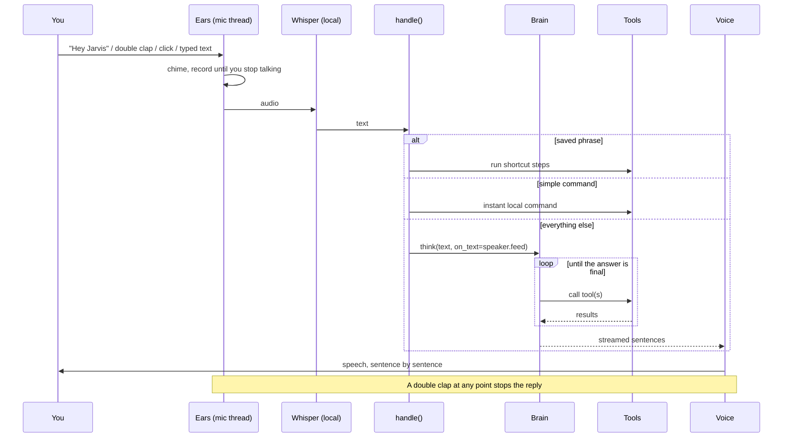

# Architecture

Jarvis is a single Python file with a few cooperating threads. This page explains how a request flows through it and why it is built this way.

## The life of a request



1. **Ears** read 80 ms audio chunks. Each chunk goes to the wake-word model and the clap detector. A click or typed text in the HUD is a third trigger.
2. **Recording** starts at the trigger and ends after about 0.9 s of silence. The recorder adapts to your voice, and a fixed level (`JARVIS_MIC_LEVEL`) can pin it.
3. **Whisper** (MLX) transcribes locally. Quiet audio is boosted first, and known hallucinations on silence ("Thanks for watching") are filtered.
4. **`handle()`** routes the text: exit and cancel phrases, then voice shortcuts, then instant local commands, then the brain.
5. **The brain** is a loop: send the conversation and the relevant tools, run any tool calls, repeat until the model answers in plain text. Text is streamed to a `StreamSpeaker` that speaks each sentence as soon as it is complete.
6. **Follow-up window**: for four seconds after a reply Jarvis keeps listening without a wake word, so conversations flow.

## Threads

| Thread | Job |
|---|---|
| main | the voice loop: read mic, detect triggers, record, transcribe, call `handle()` |
| HUD server | a small `http.server` that serves the page and streams events (Server-Sent Events) |
| speaker | plays queued sentences (`StreamSpeaker`) |
| interrupt listener | during `handle()`, watches the microphone for a double clap (`BargeIn`) |
| timers | one short-lived thread per timer |

The interrupt listener and the main loop share the microphone through a lock, and the listener pauses while Jarvis asks you a yes/no question so the two never fight over audio.

## Brains

`ChatBrain` holds the shared tool loop. `OpenAIBrain` (Groq and Gemini through their OpenAI-compatible APIs) and `OllamaBrain` only implement `_complete()` and a few message-format details. `Brain` talks to Claude. All three support streaming.

`FailoverBrain` wraps the brains you have keys for, in order. If the preferred one fails (rate limit, outage, bad key) the next answers instead, carrying over the recent conversation. The preferred brain is tried first on every turn, so it takes over again as soon as it recovers. If a reply has already started being spoken, it is not repeated by another brain.

## Speech output

Order of preference: ElevenLabs (if a key is set), Kokoro, Piper, then the macOS voice (best installed British voice: Premium, then Enhanced, then standard). Each engine has a failure flag: one error and it steps aside for the rest of the session, so Jarvis is never silent. All playback goes through one function that registers the player process, which is how a double clap can stop it instantly.

## Safety model

Threats considered:

| Threat | Mitigation |
|---|---|
| A web page or screenshot contains instructions meant for the AI ("run this command") | Content from `web_search` and `look_at_screen` marks the request as tainted; `run_shell`, `run_applescript` and `type_text` are then blocked until the next request. The system prompt also tells the model to treat that content as data. |
| The AI decides to run something destructive | `run_shell` and risky AppleScript need a spoken yes; silence is no. |
| A malicious website tries to command Jarvis through the local HUD server | Loopback only; per-run secret token on every POST; `Host` and `Origin` checks (blocks DNS rebinding); bodies are size-limited. |
| A planted `shortcuts.json` | It is a file in your home folder, like a shell profile. Treat it the same way. |
| Secrets in the repo | None are stored; keys come from the environment or `~/.jarvis/env`. |

## The HUD

A single self-contained HTML page (canvas animation, no external resources) served by the built-in server. The Python side calls `ui_emit(state, ...)`; the page listens on `/events` and animates between `boot`, `idle`, `listening`, `thinking`, `speaking` and `offline`. Colour and motion are driven by the state, and the core pulses with the live microphone level or the speech rhythm.

## Adding a tool

A tool is a function plus one line of registration.

```python
# 1. Write it. It takes simple arguments and returns a short string for the AI to read.
def tool_coin_flip(sides: int = 2) -> str:
    import random
    return f"landed on {random.randint(1, max(2, int(sides)))}"

# 2. Register it in TOOLS (name, description for the AI, argument schema, function).
("coin_flip", "Flip a coin or roll a die with the given number of sides.",
 _schema({"sides": {"type": "integer"}}), tool_coin_flip),

# 3. (Optional) add it to a group in TOOL_GROUPS so it is only sent when relevant.
```

Then run `python scripts/gen_tools_doc.py` to update the reference, and add a test next to the others in `tests/test_tools.py`. If your tool reads untrusted content, add its name to `UNTRUSTED_TOOLS`. If it can change things on the Mac, think about `SENSITIVE_TOOLS` and `confirm()`.
